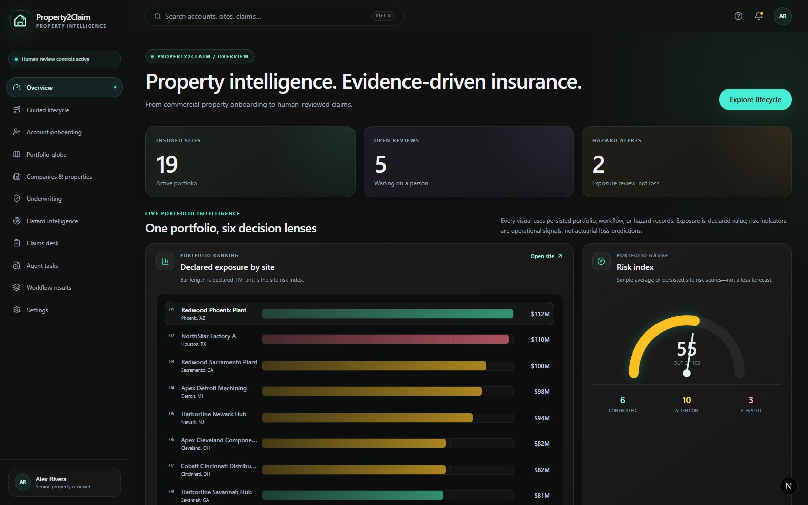
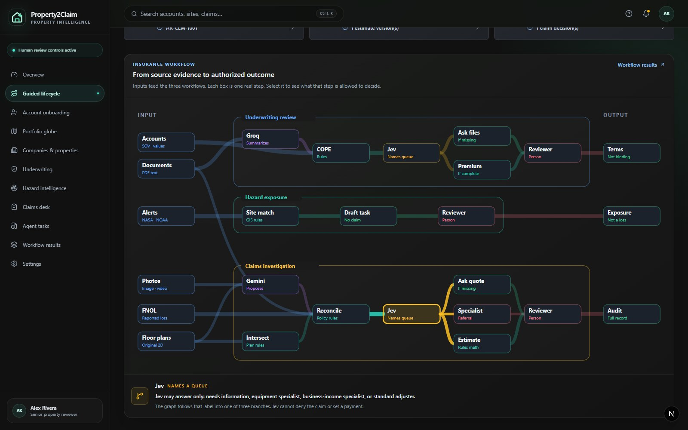
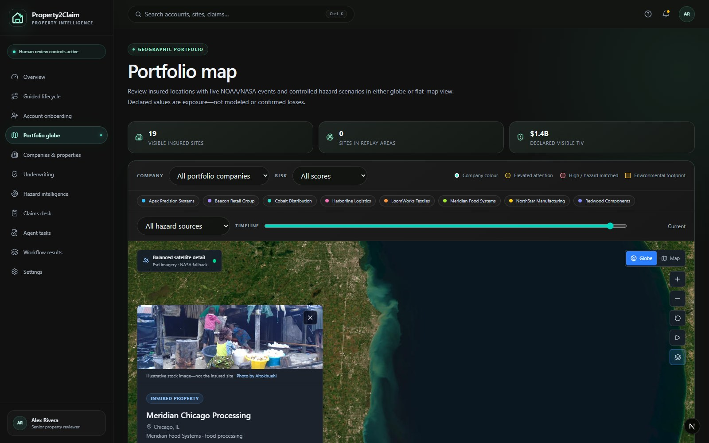
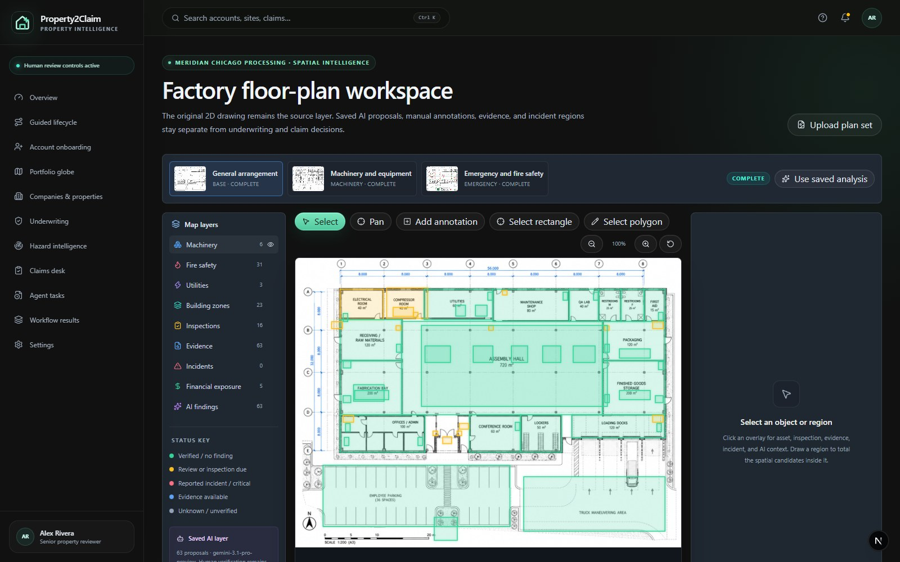
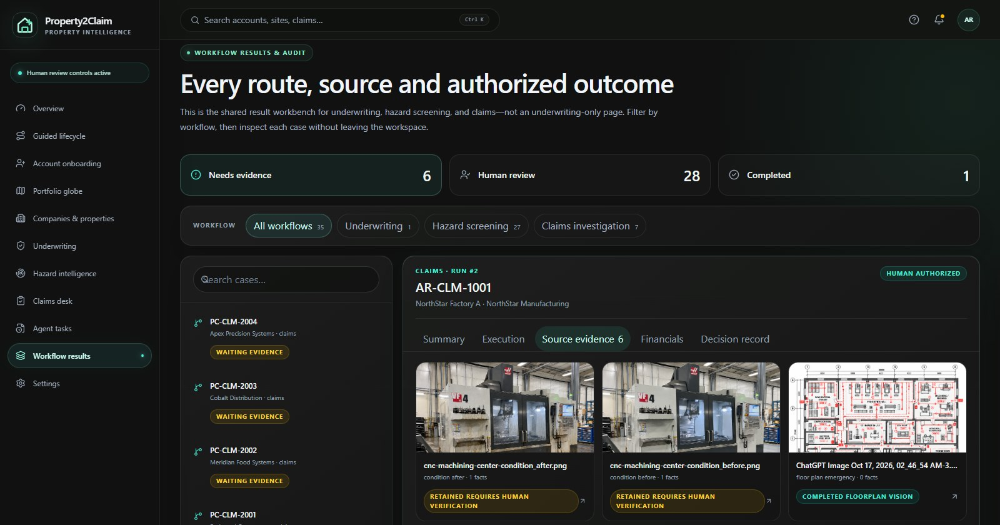

# Property2Claim

**From global property exposure to floor-level evidence and human-reviewed insurance decisions.**

Property2Claim is an AI-assisted commercial property intelligence platform that connects company onboarding, insured locations, hazard monitoring, underwriting, site plans, claim evidence, estimates, and review decisions in one traceable workspace.

Commercial property teams often work across disconnected spreadsheets, PDFs, maps, inspection reports, inboxes, policy systems, and claim files. That makes it difficult to answer three simple questions quickly: **What is exposed? What is happening at the site? What evidence supports the next decision?** Property2Claim brings those answers together through a geo-aware and site-aware operating view.

| Portfolio intelligence | Insurance workflow |
|---|---|
|  |  |
| **Selected factory on the geographic portfolio** | **Interactive original 2D site plan** |
|  |  |

### Evidence to outcome



## What the product does

Property2Claim gives insurers a connected view at two levels:

- **Geo-aware portfolio intelligence:** compare insured sites, declared exposure, company concentration, operational risk signals, and relevant NASA/NOAA hazard events on an interactive Cesium globe or flat map.
- **Site-aware intelligence:** move from a selected property into its original 2D factory plan, then inspect machinery, fire safety, utilities, zones, inspections, incidents, evidence, and financial exposure in physical context.

The same evidence then follows the case through underwriting or claim investigation. Instead of presenting an unexplained AI answer, the application records what was checked, which route was selected, what evidence was missing, which model or rule contributed, and where a qualified human must decide.

## Most impactful capabilities

- Interactive satellite globe with company-coloured sites, risk rings, hazard footprints, timeline controls, site profiles, and direct 2D-plan handoff.
- Original 2D floor-plan workspace with pan/zoom, saved vision proposals, manual annotations, toggleable insurance layers, clickable assets, region selection, and contextual evidence.
- Fifteen commercial-property insurance data categories covering company, location, COPE, values, machinery, stock, business income, policy, claims, inspections, and hazards.
- Stateful underwriting, hazard, and claims workflows with conditional routes, persisted checkpoints, role gates, and a searchable audit trail.
- Evidence-first claims workspace with machine before/after comparisons, document previews, versioned estimates, source provenance, and human review.
- Live NOAA and NASA EONET adapters, optional NASA FIRMS support, geospatial matching, and deterministic hazard replay for reliable demonstrations.
- Read-only MCP server exposing portfolio, workflow, floor-plan, evidence, document, and claim functions for controlled integration with external agents and enterprise tools.

## AI and decision architecture

Property2Claim uses AI where interpretation helps, while keeping consequential authority with people:

- **Gemini vision** proposes structured annotations from authorized floor plans and media. Results are cached and remain subject to human verification.
- **Groq-hosted language models** support source-linked text summarization where configured.
- **Jev typed judgments** select bounded review queues such as incomplete, specialist review, or standard handling; Jev cannot approve coverage or payment.
- **LangGraph** coordinates multi-step underwriting, hazard, and claim workflows with conditional branches and persisted state.
- **Deterministic insurance rules** validate required evidence, calculate transparent illustrative scenarios, and provide a reproducible fallback when external models are unavailable.

Model output is advisory. The system does not autonomously bind a policy, deny coverage, settle a claim, or authorize payment.

## Technical architecture

| Layer | Technology |
|---|---|
| Web application | Next.js 16, React 19, TypeScript, Tailwind CSS |
| API and persistence | FastAPI, Pydantic, SQLAlchemy, SQLite |
| Workflow orchestration | LangGraph with persisted workflow and audit records |
| Maps and spatial analysis | CesiumJS, Esri World Imagery, NASA GIBS fallback, Shapely, GeoJSON |
| 2D plan interaction | React Konva with normalized geometry overlays |
| Documents and tabular data | PyMuPDF, pandas, openpyxl |
| AI providers | Gemini, Groq, Jev; deterministic adapters when credentials are unavailable |
| Hazard intelligence | NOAA NWS, NASA EONET, optional NASA FIRMS |
| Agent interoperability | Python MCP server over stdio |

The repository contains two deployable processes: `frontend/` for the web experience and `backend/` for APIs, persistence, workflows, document processing, geospatial logic, and model adapters.

## Run locally

Prerequisites: Python 3.11+, Node.js 20.9+, and npm.

Backend:

```powershell
python -m venv .venv
.\.venv\Scripts\python -m pip install -r backend\requirements.txt
Set-Location backend
..\.venv\Scripts\python -m uvicorn app.main:app --reload --port 8000
```

Frontend, in a second terminal:

```powershell
Set-Location frontend
npm install
npm run dev
```

Open `http://localhost:3000`. Interactive API documentation is available at `http://localhost:8000/docs`. Copy `.env.example` to `.env` to configure optional provider credentials; the complete workflow remains usable with deterministic local adapters when keys are absent.

## Quality checks

```powershell
# Backend
Set-Location backend
..\.venv\Scripts\python -m pytest -q

# Frontend
Set-Location frontend
npm run typecheck
npm run lint
npm run build
npm audit --omit=dev
```

The current demonstration portfolio contains eight fictional companies, nineteen insured sites, seven connected claims, two saved floor-plan groups, machine before/after evidence, and persisted underwriting, hazard, and claims runs. Financial outputs are illustrative and are not actuarial predictions, coverage conclusions, or payment authority.

## MCP integration

The optional read-only MCP server allows compatible clients to query Property2Claim without receiving arbitrary filesystem access or write authority:

```powershell
Set-Location backend
..\.venv\Scripts\python -m app.mcp_server
```

It exposes seven bounded tools for portfolio, workflow, floor-plan, evidence, document, and claim retrieval—providing an integration surface for agents, spreadsheets, email workflows, policy platforms, and claim systems.

